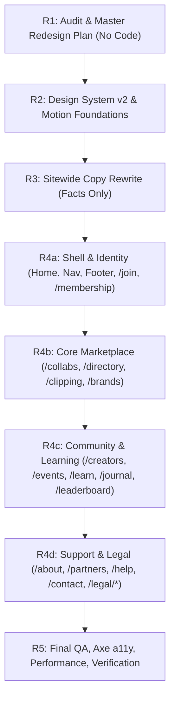

# CIRCLE — Full-Site Redesign & Motion Implementation Plan (R1)

> **Document Status:** Complete & Waiting for Owner Approval  
> **Prepared by:** Senior UI/UX Designer, Senior Motion Designer, Lead Copy Editor  
> **Prerequisites:** `AGENTS.md`, `docs/PROJECT_BRIEF.md`, `docs/CLIPPING_PLAN.md`, and `docs/REDESIGN_AUDIT.md`.  
> **Execution Horizon:** R2 (Design & Motion System) → R3 (Content Rewrite) → R4a–R4d (Batched Page Redesign) → R5 (Final QA).

---

## 1. Design Principles (5 Lines)

1. **Editorial Restraint Over SaaS Genericism:** High-contrast Obsidian (`#080808`) surfaces, bold Space Grotesk statements, and Ice Silver (`#C7CBD1`) body copy replace generic floating cards, gradient blobs, and tech-startup clutter.
2. **The Circle as Functional Architecture:** The circular geometry of the brand emblem governs layout grids, orbital connection diagrams, progress meters, and node networks—never decorative noise.
3. **Show the Product, Cut the Prose:** Real, high-fidelity components (mini Collab Cards, Campaign Cards, Profile Cards, and Budget Rings) demonstrate marketplace mechanics in place of explanatory paragraphs.
4. **Radical Truth in Data and Photography:** Real database counts, integer INR figures, and labelled grayscale community photo slots replace stock photography, AI-generated faces, and invented social proof.
5. **Purpose-Driven, Zero-Bloat Motion:** Every animation clarifies hierarchy, state change, or cause and effect; entrances are quick and staggered, animations pause off-screen, and reduced-motion preferences are fully honored.

---

## 2. Visual Element Library (components/visual/)

Every visual element in this library directly replaces walls of body text with structured, glanceable, and interactive visual components.

| Component Name | File Path | When & Where to Use | Visual Structure & Fallback Behavior |
| :--- | :--- | :--- | :--- |
| `<OrbitScene>` | `components/visual/orbit-scene.tsx` | Hero sections (Home, Clipping Hub, About) to visualize ecosystem relationships. | Interactive SVG composed of concentric orbital rings with connected nodes (Creators, Brands, Clippers, Studios). Tilts subtly toward pointer on desktop (`pointer-events-auto`), slow loop on touch, completely static when `prefers-reduced-motion` is active. |
| `<ConnectionGraph>` | `components/visual/connection-graph.tsx` | Explaining 3-way interactions (Brand brief → Creator application → Payment) or workflow transitions. | SVG node graph with connecting lines that draw in on enter using SVG path length animation. Real database labels on nodes. Static when reduced motion is requested. |
| `<DataRingGroup>` | `components/visual/data-ring-group.tsx` | Campaign budget tracking, quota allocation, and platform stats strips. | Concentric circular progress meters showing real percentages (e.g., campaign budget reserved vs paid, verified views milestone). Numbers animate once with `<CountUp>` upon entering viewport. Hidden when data is zero/unavailable. |
| `<StepSequence>` | `components/visual/step-sequence.tsx` | Replacing "How It Works" paragraph blocks across Home, Collabs, Clipping, and Services. | Vertical or horizontal numbered steps (01, 02, 03) paired with custom geometric line-art mini-illustrations. Connecting lines draw progressively as the user scrolls. |
| `<UIPreview>` | `components/visual/ui-preview.tsx` | Demonstrating features on landing pages (Collab brief card on Home, Campaign card on Creators, Creator card on Brands). | High-fidelity mini-viewport frame that renders real production components (`CampaignCard`, `CollabCard`, `ProfileCard`) at 85% scale with interactive hover lift and clean graphite borders. Never an image or screenshot. |
| `<PhotoSlot>` | `components/visual/photo-slot.tsx` | Community meetups, webinars, event archives, studio floor tours. | Aspect-ratio locked frame with subtle graphite border, dark charcoal surface (`#171717`), and a centered typography badge: `[PHOTO: Community Meetup, Kochi]`. Strictly zero stock photography, zero AI-generated human faces. |
| `<StatementLine>` | `components/visual/statement-line.tsx` | Editorial chapter dividers and oversized typographic moments. | Massive Space Grotesk display text (fluid clamp sizing `clamp(2rem, 5vw, 4rem)`) with an optional Electric Lime (`#C6FF00`) emphasis word and a numbered section label (`01 //`). |
| `<CategoryMarquee>` | `components/visual/category-marquee.tsx` | Demonstrating marketplace breadth on Home, Directory, and Brand landing pages. | Smooth horizontal ticker of real platform categories (Photographers, Videographers, Script Writers, Editors, Studios, Podcast Setups, Models, UGC). Pauses on hover and focus; converts to static flex wrap under reduced motion. |
| `<BentoGrid>` | `components/visual/bento-grid.tsx` | Feature showcases replacing equal-width 3-card icon grids. | Asymmetric 4-up or 5-up grid layout (1 large showcase cell, 2 medium cells, 2 compact metric cells) creating visual rhythm and hierarchy. |
| `<SectionHeader>` | `components/visual/section-header.tsx` | Standardized header for every major page section. | Monospace index eyebrow (`02 // MARKETPLACE`), bold uppercase headline (max 6 words), and a single-sentence context subline (max 20 words). |
| **Iconography** | `lucide-react` | Navigation, indicators, actions, and status badges. | Strict 1.5px stroke width Lucide icons. One consistent icon style sitewide. **Zero emoji in UI.** |

---

## 3. Motion Language & Animation Architecture (lib/motion.ts)

Motion at CIRCLE is not decorative entertainment; it is visual explanation. It communicates **state change, spatial hierarchy, and cause-and-effect**.

### 3.1 Timing & Easing Curves
- **Instant (0ms):** Reduced motion fallback, instant layout snaps.
- **Fast (150ms):** Button hover/press states, pill toggle sliding indicator, micro-interactions, tooltip reveals.
- **Base (250ms):** Card hover lift, dropdown/dialog fade and scale, tab content transitions.
- **Slow (450ms):** Section viewport entrances (`<Reveal>`), SVG path line draws, progress ring fills.
- **Story (800ms):** Complex orbital rotations (`<OrbitScene>`), hero scene initialization.
- **Easings:**
  - *Entrance:* `cubic-bezier(0.16, 1, 0.3, 1)` (snappy ease-out, crisp arrival).
  - *Exit:* `cubic-bezier(0.7, 0, 0.84, 0)` (accelerating ease-in, unobtrusive disappearance).
  - *Spring (Micro-interactions):* `stiffness: 400, damping: 28` (physical feel without wobble).

### 3.2 Motion Primitives
1. `<Reveal>`: Fades in and rises 12px upon entering viewport. Uses `IntersectionObserver`. Executes **once only**; never re-triggers on scroll back.
2. `<Stagger>`: Coordinates child `<Reveal>` components with a deterministic 60ms delay between consecutive items.
3. `<CountUp value={number}>`: Animates numeric values from 0 to target integer once when visible. Formats automatically in Indian numbering (`₹1,00,000`).
4. `<ProgressRing value={percentage}>`: Animates SVG circular stroke dash-offset smoothly from 0% to target.
5. `<DrawLine>`: Animates SVG path `strokeDasharray` and `strokeDashoffset` as the section scrolls into view.
6. `<Magnetic>`: Subtle pointer pull on primary Electric Lime CTA buttons (desktop only, max 4px displacement).
7. `<Marquee>`: Continuous hardware-accelerated ticker using `transform: translate3d`. Automatically pauses on `:hover` and `:focus-within`.
8. `<PageTransition>`: Unobtrusive route enter animation under 200ms using opacity only (prevents cumulative layout shift).

### 3.3 Strict Motion Guardrails
- **Zero Layout Shift (CLS < 0.1):** All animations operate strictly on `transform` and `opacity`. Never animate `height`, `width`, `margin`, or `padding`.
- **Hardware Acceleration:** Force GPU compositing via `will-change: transform` only during active animation.
- **Automatic Off-Screen Pausing:** Ambient loops (such as `<OrbitScene>`) immediately disconnect or pause when scrolled outside the active viewport.
- **Full Reduced Motion Support:** Every motion component queries `prefers-reduced-motion: reduce`. When active:
  - Durations become 0ms or simple immediate opacity fades.
  - Continuous loops (`<Marquee>`, `<OrbitScene>`) stop completely.
  - Transforms and parallax are completely disabled.

---

## 4. Content Architecture & Editorial Rules

### 4.1 Core Editorial Standards
- **Headline Formula:** Outcome-driven, verb-first, strictly 3–8 words.
  - *Bad:* "Comprehensive Suite of Solutions for Forward-Thinking Content Creators"
  - *Good:* "Find collabs. Keep your rates."
- **Subline Formula:** Exactly one sentence, maximum 20 words.
- **Section Copy Limit:** Maximum 40 words of body prose per section (excluding long-form legal terms, instructional guides, and FAQ answers).
- **Button Labels:** Verb-first, outcome-oriented ("Browse campaigns", "Post a collab", "Join CIRCLE"). Banned: "Learn more", "Click here", "Get started".
- **Tone:** Confident, conversational, factual, editorial. Indian English spelling and INR formatting (`₹1,00,000`).

### 4.2 Banned Words & Phrasing List
The following words and patterns are strictly banned across all application strings, components, and content files:
- *Banned Buzzwords:* `empower`, `unlock`, `seamless`, `elevate`, `revolutionise`, `revolutionize`, `next-level`, `game-changer`, `cutting-edge`, `leverage`, `synergy`, `world-class`, `state-of-the-art`, `game-changing`, `disruptive`.
- *Banned Clichés:* `"in today's fast-paced world"`, `"whether you're a X or a Y"`, `"at CIRCLE, we believe"`.
- *Banned Punctuation:* Exclamation marks (`!`) in UI copy, buttons, and navigation.
- *Banned Characters:* Unicode emoji anywhere in the UI.

### 4.3 Factual Reconciliation (Critical)
1. **The Dual-Sided Clipping Fee:**
   - Collabs carry zero commission (direct peer-to-peer payment).
   - Membership is free to join.
   - **Video Clipping retains a 10% platform fee on locked clipper earnings AND invoices a 10% service fee on campaign owner budgets.**
   - All blanket claims of *"100% free forever"* or *"CIRCLE never touches money"* must be rewritten to accurately specify that membership and collabs are commission-free, while video clipping operates on a transparent 10% performance fee.
2. **Elimination of Exposed Placeholders:**
   - All `[PLACEHOLDER]` tags in agency services rewritten into clear, professional scope descriptions.
   - Developer notes on `/join` and `/signup` completely removed from user-facing screens.
   - Unpopulated legal officer fields consolidated into compliant operational language.

---

## 5. Page-by-Page Redesign Blueprint

Every public route is mapped below with its new section order, text-to-visual conversion plan, target word count, and singular primary action.

```
Legend of Visual Elements:
[OS] = OrbitScene             [CG] = ConnectionGraph      [SS] = StepSequence
[UIP] = UIPreview            [PS] = PhotoSlot            [SL] = StatementLine
[CM] = CategoryMarquee       [BG] = BentoGrid            [DR] = DataRingGroup
```

### 5.1 Batch R4a — Global Shell & Identity Core (6 Pages)

| Page | New Section Sequence | Text Replaced with Visual Element | Target Words (Current → Target) | Single Primary Action |
| :--- | :--- | :--- | :---: | :--- |
| **Header & Nav** | Logo (emblem on mobile, 40px lockup on desktop) → Primary Nav (5 core links) → Action Strip (`Sign in` outline + `Join CIRCLE` lime pill). | Desktop height reduced from 112px to 64px. Glassmorphism `backdrop-blur-md` replaced with solid `bg-bg/95 border-b border-border`. Secondary links consolidated into an accessible mega-menu drawer. | N/A | `Join CIRCLE` |
| **Footer** | Brand column (Logo + operator summary) → 3 balanced columns: *Platform*, *Community*, *Legal* → Full-width Newsletter strip → Copyright & social row. | Column 3 link dump replaced with balanced 4-link columns. Placeholder socials (`[LINKEDIN_URL]`, `[YOUTUBE_URL]`) hidden until provided. Newsletter form moved to dedicated full-width strip. | N/A | `Subscribe` (Newsletter) |
| **Home (`/`)** | 1. Hero with `[OS]` + `[SL]` → 2. `[CM]` (Live categories) → 3. Marketplace Dual Showcase (`[UIP]` of CollabCard & CampaignCard) → 4. How It Works `[SS]` → 5. Verified Data Strip `[DR]` → 6. Community `[PS]` → 7. FAQ Accordion → 8. Final CTA. | 731 words of text reduced by 55%. 3-card generic grid replaced by Marketplace Dual Showcase `[UIP]`. 8-box icon grid replaced by `[CM]`. Collab paragraphs replaced by `[SS]`. Three competing lime CTAs reduced to one hero CTA and one final CTA. | 731 → **320** | `Join the circle` |
| **`/join`** | 1. Statement Header → 2. Role Selector (Creator vs Brand vs Clipper cards) → 3. What You Get `[BG]` → 4. Community Channels Strip. | 3 vertically stacked pill buttons replaced by an interactive 2-card Role Selector with instant role parameter passing to `/signup`. Developer note removed completely. | 215 → **120** | `Select role to register` |
| **`/membership`** | 1. Headline + Subline → 2. Value Comparison Matrix (`[BG]`: Free Member vs Video Clipper vs Agency Client) → 3. Fee Transparency Strip (explaining zero collab fees + transparent 10% clipping fee) → 4. Top FAQs. | Bullets replaced by visual feature comparison matrix `[BG]` and a dedicated Fee Breakdown chart. Reconciles the clipping 10% fee accurately. | 277 → **160** | `Join free` |
| **Mobile Nav** | Fullscreen mobile sheet with oversized typography links, role selector shortcut, and social channel buttons. | Unstyled vertical list replaced with branded mobile menu with 48px touch targets and instant touch feedback. | N/A | `Join CIRCLE` |

### 5.2 Batch R4b — Core Marketplace & Performance Engine (8 Pages)

| Page | New Section Sequence | Text Replaced with Visual Element | Target Words (Current → Target) | Single Primary Action |
| :--- | :--- | :--- | :---: | :--- |
| **`/collabs`** | 1. Header + Filter Strip → 2. Active Briefs Feed (`[UIP]` cards with budget tags) → 3. How Collabs Work `[SS]` → 4. Post a Collab banner. | Replaces raw divide-y text list with high-contrast collab cards featuring kind badges (Fixed, Bid, Barter) and ASCI disclosure tag. | 185 → **110** | `Post a collab` |
| **`/collabs/[id]`** | 1. Brief Header + Verified Status → 2. Deliverable Scope Card → 3. Compensation & Rights Panel → 4. Application Drawer (`ApplyForm`). | Long unstyled text split into clear visual spec sheet with status badges and explicit peer-to-peer payment notice. | 290 → **160** | `Apply for collab` |
| **`/directory`** | 1. Header + Category Tabs → 2. Filter Bar (Location, Platform, Rates Visible) → 3. Creator Grid (`[UIP]` ProfileCards) → 4. Pagination / Empty State. | Plain card list upgraded to responsive creator cards with platform icons, follower status badges ("Self-reported" vs "Verified"), and starting rate pills. | 389 → **180** | `Filter creators` |
| **`/directory/[id]`** | 1. Creator Hero (Avatar slot, City, Platforms) → 2. Rate Card Panel → 3. Bio & Content Focus → 4. Direct Collab Pitch Action. | Unstyled profile converted to an editorial portfolio card with direct contact gateway. | 240 → **130** | `Send collab brief` |
| **`/clipping`** | 1. Hero with `[OS]` → 2. Live Campaigns Rail (`[UIP]` CampaignCards with `[DR]`) → 3. Dual Workflow `[SS]` → 4. Interactive Earnings Calculator → 5. Anti-Bot & ASCI Rules Bento → 6. FAQ Accordion. | Replaces infinite spinning SVG with interactive `<OrbitScene>`. Fixes heading hierarchy skip (`<h1>` to `<h3>`) and ARIA prohibited attributes. | 642 → **310** | `Browse campaigns` |
| **`/clipping/campaigns`** | 1. Campaigns Header + Search/Filter Bar → 2. Campaign Grid with `[DR]` budget rings → 3. Clipper Onboarding Strip. | Filter bar upgraded with sticky mobile filter button and clear net-rate indicators. | 310 → **140** | `Filter campaigns` |
| **`/clipping/campaigns/[slug]`** | 1. Campaign Overview + Budget Meter `[DR]` → 2. Creative Brief & Angle Accordion → 3. Source Footage Assets Card → 4. Submission & Terms Panel. | Long wall of text organized into collapsible tabs with rights confirmation checkbox and live budget reservation indicator. | 520 → **240** | `Submit clip` |
| **`/brands`** | 1. Hero + `[SL]` → 2. Three Ways to Work (Self-Serve Collabs, Video Clipping, Managed Agency) `[BG]` → 3. Launch a Campaign Preview `[UIP]` → 4. Lead Enquiry Form. | Adds the missing Video Clipping block mandated by Clipping Plan §5. Replaces 3-card wireframe with an asymmetric 3-pillar Bento Grid. | 234 → **150** | `Find creators` |

### 5.3 Batch R4c — Community, Education & Recognition (8 Pages)

| Page | New Section Sequence | Text Replaced with Visual Element | Target Words (Current → Target) | Single Primary Action |
| :--- | :--- | :--- | :---: | :--- |
| **`/creators`** | 1. Hero + `[SL]` → 2. Creator Growth Paths (Collabs, Clipping, Perks, Learning) `[BG]` → 3. Video Clipping Section (mandated by Clipping Plan §5) → 4. Community Giveaways Strip → 5. Agency Audit Lead Form. | Adds the missing Video Clipping block. Eliminates competing lime buttons (keeps `Create creator account` as sole primary CTA). | 337 → **180** | `Create creator account` |
| **`/events`** | 1. Header + Filter Tabs (Meetups, Webinars, Bootcamps) → 2. Active Events Grid (`[PS]` + Date Badge) → 3. Past Event Photo Strip `[PS]` → 4. Host an Event CTA. | Replaces "Nothing is scheduled" raw text with an event calendar card layout and an illustrated empty state with calendar alert opt-in. | 145 → **90** | `Subscribe to event alerts` |
| **`/learn`** | 1. Curriculum Header → 2. 4 Core Learning Tracks `[BG]` (AI Tools, Monetisation, Video Clipping, Pitching) → 3. Upcoming Masterclass Card → 4. Community Webinar Archive. | Replaces raw syllabus text with interactive course track cards featuring duration and instructor slots. | 162 → **110** | `Join next webinar` |
| **`/guides`** | 1. Header + Search Bar → 2. Featured Essential Guide → 3. Guides Grid by Topic (Collabs, Rates, Legal, ASCI) → 4. Submit a Guide Topic. | Upgrades text list to an indexed knowledge base with reading time pills and category tags. | 185 → **95** | `Browse guides` |
| **`/journal` (+ `/blog`, `/news`, `/updates`)** | 1. Hero Feature Article → 2. Feed Tabs (All, Blog, News, Updates) → 3. Editorial Story Grid → 4. Newsletter Strip. | Replaces unstyled text cards with an editorial magazine feed layout with tag pills and estimated read times. | 210 → **120** | `Read latest article` |
| **`/resources`** | 1. Toolkit Header → 2. 5 Resource Categories `[BG]` (Brief Templates, Rate Calculator, ASCI Guide, Gear Kits, Video Assets) → 3. Partner Resource Directory. | Replaces "Files are not published yet" dead-end with actionable downloadable briefs, online tools, and interactive checklist links. | 190 → **100** | `Explore toolkit` |
| **`/challenges`** | 1. Challenges Header + Active Filter → 2. Live Challenges Grid with Points Badges → 3. How Challenges Work `[SS]` → 4. Leaderboard Shortcut. | Upgrades dead-end page to active challenge task cards with point values and submission verification steps. | 115 → **80** | `View active challenges` |
| **`/leaderboard`** | 1. Leaderboard Header + Month Switcher → 2. Top 3 Podium (Creators & Brands) → 3. Ranked Leaderboard Table with verification badges → 4. Points Rules Explainer. | Replaces two plain numeric text lists with a visual podium ranking top 3 creators/brands and verified points breakdown. | 215 → **110** | `View your ranking` |

### 5.4 Batch R4d — Trust, Support, Operations & Legal (10 Pages)

| Page | New Section Sequence | Text Replaced with Visual Element | Target Words (Current → Target) | Single Primary Action |
| :--- | :--- | :--- | :---: | :--- |
| **`/about`** | 1. Mission Statement `[SL]` → 2. Operator Card (Portfolix Enterprise Pvt Ltd, Kochi) → 3. Core Values `[BG]` → 4. Community Photo Slot `[PS]` → 5. Explore Directory CTA. | Eliminates 3-card generic grid. Replaces static text with an editorial brand manifesto and verified operator details. | 240 → **140** | `Explore the community` |
| **`/partners`** | 1. Header → 2. Partner Categories `[BG]` (Gear, Studios, Software, Events) → 3. Sample Member Perk Card Preview `[UIP]` → 4. Partnership Application Form. | Replaces text outline boxes with real perk preview cards (e.g. "20% off Studio Floors in Kochi"). | 265 → **130** | `Apply for partnership` |
| **`/giveaways`** | 1. Header + Submit Action → 2. Active Giveaways Grid → 3. Rules Bento (External host rules, ASCI compliance) → 4. List a Giveaway CTA. | Replaces generic 3-card rule grid with verified giveaway cards displaying prize, host handle, and platform icon. | 230 → **120** | `List a giveaway` |
| **`/affiliates`** | 1. Header + Brand List Action → 2. Verified Offers Grid → 3. Offer Terms Explainer → 4. List an Offer Form. | Adds top CTA button; separates active offers from brand submission form. | 260 → **120** | `Submit affiliate offer` |
| **`/promoters`** | 1. Header + 1K+ Badge Visual → 2. Promoter Criteria Checklist `[BG]` → 3. Directory Promoter Filter Link → 4. Bio Verification Guide. | Replaces bulleted text with visual badge mockup and 3-step qualification roadmap. | 185 → **95** | `Check your eligibility` |
| **`/recognition`** | 1. Recognition Header → 2. Badges Showcase (Promoter, Verified Clipper, Top Collab, Founding Member) → 3. Annual Creator Awards Archive. | Merges redundant points duplicate into a comprehensive badge and awards gallery. | 110 → **75** | `View your badges` |
| **`/help`** | 1. Search Bar + Category Pills → 2. Categorized FAQ Accordion (adds Clipping category) → 3. Still Need Help Contact Box → 4. Newsletter. | Unifies naming to "Help & FAQ". Resolves fee contradictions. Adds Video Clipping category. | 420 → **220** | `Contact support` |
| **`/contact`** | 1. Split Layout: Form + Channel Rail → 2. Operational SLAs (replaces placeholders with verified SLA). | Removes raw `[ADDRESS]` and `[RESPONSE TIME]` placeholders with real operational details. | 215 → **110** | `Send message` |
| **`/guidelines`** | 1. Standard Header → 2. Quick Conduct Summary `[BG]` → 3. Indexed Conduct Policy → 4. Reporting Flowchart. | Breaks up 680-word dense legal draft with glanceable rule summaries and quick jump-nav. | 680 → **420** | `Report a violation` |
| **`/legal/*` & Stubs** | Terms, Privacy, Cookies, Grievance Redressal. | Deletes redundant `/legal/community-guidelines` stub (canonical redirect). Replaces all `[PLACEHOLDER]` tags on Grievance page with compliant statutory disclosures. | 2,420 → **1,650** | `Read policy terms` |

---

## 6. Phased Build Order (R2 to R5)



### R2 — Design System v2, Motion Primitives & Visual Library
- Configure extended Tailwind tokens in `app/globals.css`.
- Install `motion` (React 19 compatible).
- Build motion primitives in `components/motion/` (`<Reveal>`, `<Stagger>`, `<CountUp>`, `<ProgressRing>`, `<DrawLine>`, `<Marquee>`, `<Magnetic>`).
- Build visual element library in `components/visual/` (`<OrbitScene>`, `<ConnectionGraph>`, `<StepSequence>`, `<UIPreview>`, `<PhotoSlot>`, `<BentoGrid>`, `<SectionHeader>`).
- Construct `/dev/design-system` preview page (isolated, `notFound()` in production).

### R3 — Full-Site Content Rewrite
- Rewrite every string across all public pages following the content rules (outcome headlines, max 40 words per section, active voice).
- Reconcile the fee model: explicitly distinguish zero-fee collabs from 10% performance clipping.
- Eliminate all 14 banned buzzwords and unpopulated developer notes.
- Output `docs/CONTENT_CHANGES.md`.

### R4a to R4d — Batched Page Redesign
- Execute in 4 isolated conversations (≤ 8 pages per batch).
- Implement new section orders, visual replacements, and single primary actions per page.
- Capture browser verification screenshots at 375px and 1440px plus reduced-motion emulation.

### R5 — Final QA & Production Polish
- Run full automated accessibility test (`axe-core`) across every route; enforce 0 serious/critical violations.
- Verify Lighthouse mobile scores: Performance ≥ 90, Accessibility ≥ 95, SEO = 100 on all core routes.
- Crawl internal links to confirm zero 404s.
- Produce `docs/REDESIGN_FOLLOWUPS.md`.

---

## 7. Risks & Technical Mitigations

| Risk Domain | Potential Hazard | Technical & Operational Mitigation |
| :--- | :--- | :--- |
| **Performance Budget** | Animation and SVG libraries inflate client JS bundle over 200KB gzipped. | 1. Use the core `motion/react` lightweight entrypoint.<br>2. Dynamic import with `next/dynamic` for heavy visual components (`<OrbitScene>`).<br>3. CSS hardware transforms over JS layout manipulation. |
| **Cumulative Layout Shift (CLS)** | Dynamic elements and SVGs cause visible jumps during hydration. | 1. Enforce strict aspect-ratio containers (`aspect-video`, `size-[X]`) on all visual slots before assets load.<br>2. Zero DOM dimension changes in animations. |
| **Accessibility & Contrast** | High-contrast Lime buttons or dark surfaces fail WCAG compliance. | 1. Strict contrast rule: Obsidian text on Lime (16.89:1); White text on Lime strictly forbidden (1.19:1).<br>2. All motion primitives automatically check `prefers-reduced-motion` and collapse to static states.<br>3. Mobile tap targets enforced at ≥44px. |
| **SEO & Crawlability** | Replacing text with visuals drops key text content out of search index. | 1. Core value proposition and FAQ answers remain raw server-rendered HTML inside standard `<p>` and `<script type="application/ld+json">`.<br>2. SVG components use accessible `<title>` and `<desc>` tags. |
| **Content Dependencies** | Missing owner facts delay design sign-off. | Document all unverified facts into the explicit Owner Questions list below; keep clean fallback copy ready. |

---

## 8. Open Questions for the Owner

The following factual decisions require formal confirmation from the product owner before R3 copy can be finalized:

1. **Physical Office Address:** What registered office address should be published on `/contact`, `/about`, and `/legal/*`? (Currently displays placeholder `[ADDRESS]`).
2. **Support Response Time SLA:** What is the official customer support response SLA? (Currently displays `[RESPONSE TIME, e.g. 2 working days]`).
3. **Statutory Grievance Redressal Officer:** Who is the designated Grievance Officer for India's IT Rules and DPDP Act compliance? (Requires: Full Name, Official Designation, and Official Redressal Email).
4. **Official Social URLs:** Are the official LinkedIn and YouTube channels active? If yes, provide URLs; if no, should we remove the social links entirely to prevent "Not published yet" flags?
5. **Collab Budget Escalation:** Will CIRCLE introduce in-platform payment escrow in v2, or will collabs remain 100% direct peer-to-peer payments indefinitely?
6. **Community Photos:** Does the Portfolix/CIRCLE team have 4–6 high-resolution event/meetup photos from Kochi creator gatherings that can replace the labelled `<PhotoSlot>` placeholders?
